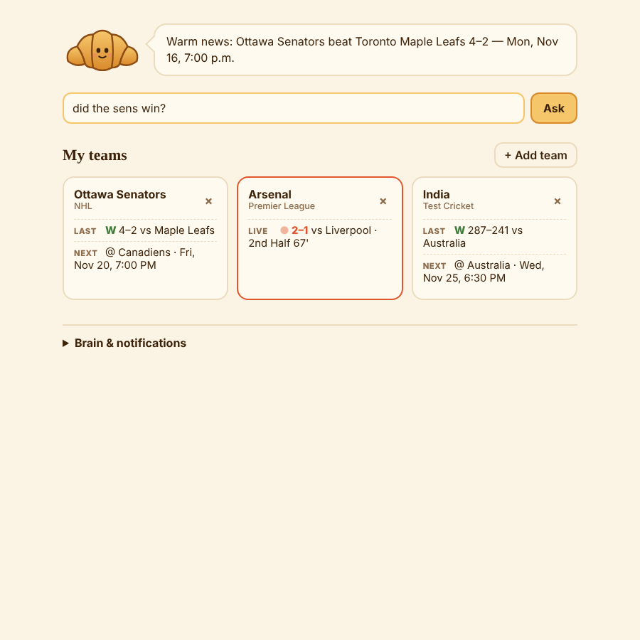

<p align="center"></p>

<h1 align="center">Croissant</h1>
<p align="center"><em>A little company. A little scoreboard.</em><br>
Your favourite teams, fresh out of the oven: no more Googling "did the Sens win".</p>

---

Croissant is a small, friendly companion that only cares about **your** teams. Ask it in plain words ("did the sens win?", "when do Arsenal play next?", "how's India doing right now?") and it answers from live data. Leave it open and it taps you on the shoulder for kickoffs, every score change, and the final whistle.

<p align="center"></p>

## Why

Checking a score usually means opening Google or a score app, wading through ads, news and leagues you don't follow, and finding your team in the pile. Croissant flips that around: you tell it who you cheer for once, and it brings back only that.

## What it does

- **Ask in plain English.** Results, live scores, next fixtures, or a digest of everything. It learns nicknames too (`croissant alias "Ottawa Senators" sens`).
- **Live nudges.** Kickoff, score changes and finals as desktop notifications or a terminal bell. It checks every 30 s during a game, every 2 min close to start time, and every 15 min otherwise.
- **Many sports.** NHL, NBA, WNBA, NFL, MLB, MLS, Premier League, LaLiga, Bundesliga, Serie A, Ligue 1 and the Champions League via ESPN, plus cricket, rugby, CFL and smaller leagues via TheSportsDB.
- **Choose your brain.** The built-in brain needs no AI and no keys. Switch to a local model (Ollama) or a cloud model (Claude, OpenAI) for chattier answers. Same croissant either way.
- **A bit of personality.** It sleeps when nothing's on, blinks, hops when there's news, and wiggles if you pet it.

## Quick start

Requires Node 20+. No dependencies to install.

```bash
git clone https://github.com/snj3vpaul/Croissant.git
cd Croissant
npm link                       # optional: puts `croissant` on your PATH

croissant add "Ottawa Senators"
croissant add Arsenal
croissant alias "Ottawa Senators" sens

croissant "did the sens win?"
# 🥐 Warm news: Ottawa Senators beat Toronto Maple Leafs 4–2 — Mon, Nov 16, 7:00 p.m.

croissant serve                # web companion at http://127.0.0.1:4242
croissant watch                # terminal mode: announces goals and finals
```

Without `npm link`, use `node bin/croissant.js …` instead.

## Commands

| Command | What it does |
| --- | --- |
| `croissant` | Digest: last result, live score, next game for every favourite |
| `croissant "<question>"` | Ask anything about your teams |
| `croissant add <team>` | Search and add a favourite |
| `croissant remove <team>` / `list` | Manage favourites |
| `croissant alias <team> <nickname>` | Teach a nickname |
| `croissant watch` | Stay open and announce kickoffs, scores and finals |
| `croissant serve [--port N]` | Run the web companion (installable as a PWA) |
| `croissant brain <rules\|ollama\|anthropic\|openai> [model]` | Pick the brain |

## Brains

| Brain | Runs | Needs |
| --- | --- | --- |
| `rules` (default) | Your machine | Nothing |
| `ollama` | Your machine | [Ollama](https://ollama.com) running, default model `llama3.2` |
| `anthropic` | Cloud | `ANTHROPIC_API_KEY`, default model `claude-haiku-5-5` |
| `openai` | Cloud | `OPENAI_API_KEY`, default model `gpt-4.1-mini` |

Model brains are grounded. They receive the match data Croissant fetched plus your question, and they're told to answer only from that data, so they can't invent a score. If a model brain fails, the built-in brain answers instead.

## How it works

```
bin/croissant.js        CLI
src/server.js           local web companion + live updates (SSE), bound to 127.0.0.1
src/tracker.js          adaptive polling, diffs snapshots into kickoff/score/final events
src/brain/rules.js      intent + team detection, warm one-liners (no AI)
src/brain/llm.js        optional Ollama / Claude / OpenAI phrasing, grounded in match data
src/providers/espn.js   ESPN public site API (major leagues, live status)
src/providers/thesportsdb.js   long tail: cricket, rugby, CFL, more
src/match.js            the one Match shape every provider returns
public/                 the companion UI (vanilla JS, no build step)
```

Adding a data source means writing one file with `searchTeams(query)` and `getMatches(team)` that return the shared `Match` shape.

## Privacy

Private by default: no accounts, no analytics, no telemetry. Your favourites live in `~/.croissant/config.json`. API keys are read from environment variables and are never written to disk. See [PRIVACY.md](PRIVACY.md).

## Caveats

- ESPN's site API is public but unofficial and could change without notice. TheSportsDB's free key is rate-limited; set `THESPORTSDB_KEY` if you have a supporter key.
- Cricket scores come through as plain totals; detailed innings breakdowns aren't parsed yet.

## Roadmap ideas

- Menu-bar / tray app wrapper (Tauri) so Croissant can sit on the desktop like a real pet
- Phone push via ntfy.sh for when you're away from the computer
- Standings and "what does tonight mean for the playoff race?"
- Spoiler shield: hide results until you've watched the replay

## Credits

Inspired by [Buntini](https://sagardas.info/products/buntini/) by Sagar Das, a tiny desktop cat companion that's private by default and powered by the AI you choose. Croissant borrows that spirit and points it at the scoreboard.

MIT licensed.
